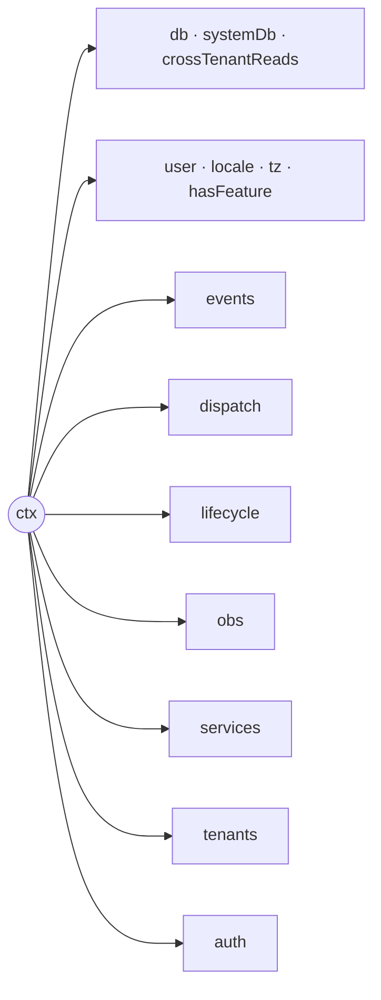

# Handler context and embedded fields

A write handler has two boundaries to keep explicit: what belongs to the
handler's transaction, and what belongs to shared infrastructure. Embedded
fields add a third boundary in the UI: structured values must never be
silently coerced into text.

## What `ctx` carries

Since 0.390.0 the handler context groups its members by purpose. Data access
and the caller sit at the top level; everything else lives in a namespace:



| Namespace | Members | Use it for |
|---|---|---|
| `ctx.db` | TenantDb methods, `outsideTransaction` | rows of the caller's tenant, inside or outside the handler transaction |
| `ctx.systemDb` | `assertTenantMatch`, `assertRowsTenant`, `acknowledgeCrossTenant`, `unsafeRaw` | `r.systemScope()` features only |
| `ctx.crossTenantReads` | `selectMany`, `fetchOne`, `count` | read-only access to other tenants, only with an `escapeHatch` grant |
| `ctx.events` | `append`, `unsafeAppend`, `tryAppend`, `fetchForWriting`, `load`, `loadWithSnapshot`, `snapshot`, `archive`, `restore`, `isArchived` | event streams of the feature |
| `ctx.dispatch` | `query`, `write`, `queryAs`, `writeAs`, `queryAsMember`, `queryProjection` | calling other handlers |
| `ctx.lifecycle` | `afterCommit`, `afterRollback`, `signal`, `runPreSave` | work after commit or rollback, cancellation |
| `ctx.obs` | `log`, `tracer`, `metrics`, `metricsFor`, `meter` | logging, traces and metrics |
| `ctx.services` | `redis`, `cacheSync`, `jobRunner`, `searchAdapter`, `entityCache`, `secrets`, `kms`, `files`, `derivatives`, `configResolver`, `configEncryption`, `rateLimit`, `effectiveFeatures`, `masterKeyProvider`, `extensions` | injected infrastructure; unknown `extraContext` keys of the app land in `extensions` |
| `ctx.tenants` | `config(tenantId)`, `writeTarget(tenantId)` | config of a tenant, writes into another tenant's stream |
| `ctx.auth` | `resolveClaims`, `resolveActiveMembership` | auth features |

A job context carries subsets: `events.append`, `dispatch.write`, `writeAs`,
`queryAs` and `queryAsMember`, `obs.log`, `metricsFor` and `meter`,
`lifecycle.signal` and the same `services`. The flat names (`ctx.appendEvent`,
`ctx.write`, `ctx.log`, `ctx.scheduleAfterCommit`, `ctx.configFor`, …) are gone
without aliases; `kumiko-upgrade --apply` rewrites them, see
[Upgrading to 0.392](upgrading-to-0-392.md).

```ts illustration
handler: async (event, ctx) => {
  const invoice = await ctx.db.fetchOne(invoiceTable, { id: event.payload.id });
  if (!invoice) throw new NotFoundError("invoice");
  await ctx.events.append({ type: "invoice:sent", aggregateId: invoice.id, aggregateType: "invoice", payload: {} });
  ctx.lifecycle.afterCommit?.(() => ctx.obs.log.info("invoice sent", { id: invoice.id }));
  return { isSuccess: true, data: { id: invoice.id } };
},
```

Helpers that need part of the context take that part, not the whole context.
Framework subpaths export only names that some consumer imports (since
0.390.0); a helper type you used to import may now be internal. Name the
members your helper reads with `Pick<HandlerContext, "db" | "obs">` instead of
importing an internal type.

## Start with the owning feature

Shared code that records a metric should not bind to whichever feature happened
to call it. Declare the metric in the library-owning feature and use
`ctx.obs.metricsFor` at the call site:

```ts illustration
const metrics = ctx.obs.metricsFor("ai-foundation");
metrics.inc("provider_call_total", { provider: "acme" });
```

The explicit feature name gives the metric one stable
`kumiko_<feature>_<metric>` name across all consumers. Feature names may use
the same kebab-case used by `defineFeature`; the framework normalises the name
for metric registration and lookup. An unregistered target is a no-op, which
keeps an error-path counter from turning a handled error into a new exception.
Other failures — invalid names or metric-type mismatches — still surface.

## Keep the transaction choice visible

`ctx.db` is tenant-scoped and bound to the current write transaction. A failed
handler rolls back writes made through it, including nested writes made through
the dispatcher.

`ctx.db.outsideTransaction` is also tenant-scoped, but uses the unbound pool.
Writes through it survive a rollback of the handler transaction. Use it only
to record a fact whose external side effect has already happened and must not
be forgotten when the business write fails — for example, a provider charge
acknowledgement or a delivery-attempt record. It is not a replacement for
`ctx.db` and does not make an otherwise atomic workflow atomic. On an
`r.systemScope()` handler it is fail-closed exactly like `ctx.db` — reach for
`ctx.systemDb.outsideTransaction` instead (see below).

Hard constraints when using `ctx.db.outsideTransaction`:

- **No overlapping locks.** Outside-tx writes must only touch tables/rows the
  open handler transaction does **not** lock (typically append-only log tables).
  Writing the same entity/stream the handler tx already touched deadlocks until
  statement timeout — the pool connection waits on a lock only the waiting tx
  can release.
- **Pool capacity.** Each outside-tx acquire holds a second connection while the
  handler tx still holds its first. Under load (every pool slot in open handler
  txs) outside-tx acquires block until acquire timeout. Size the pool for
  concurrent (handler + outside) pairs, or keep outside-tx use rare.


## Capped handlers reserve before the transaction

A handler wrapped in `withCapEnforcement(handler, capResolver)` from `cap-counter` does not check or book its cap inside the handler transaction. The wrapper sets `reserveBeforeTransaction`, and the dispatcher runs it first, after the access and schema checks and before any transaction opens:

1. The resolver returns the cap for this request (`capName`, `periodStartIso`, `limit`, `profile`, `notify`, optional `amount`).
2. `enforceCapAndMaybeNotify` throws `CapExceededError` on a hard hit, so the handler never runs.
3. The amount is reserved in its own short, immediately committed write.
4. If the handler transaction ends without committing (rollback, failure result, failed commit), the dispatcher calls the returned release and gives the amount back.

In the reservation phase the same surfaces are blocked as in `beforeTransaction`: `ctx.dispatch.write`, `ctx.dispatch.writeAs`, `ctx.lifecycle.afterCommit`, `notify` and `ctx.services.jobRunner` throw an `InternalError`, so the reservation cannot start nested commands.

No connection is held across the handler, so capped requests cannot exhaust the pool, and the counter stream is not locked while the handler runs. A reservation covers one top-level command. A capped handler reached through a nested `ctx.dispatch.write`, `ctx.dispatch.writeAs` or a second run of the same type finds the reservation spent and fails with an `InternalError`. Book the nested work from the top-level handler instead, or make the capped handler the top-level command. If a commit fails with an unknown outcome, the release can under-count, so a wrapped handler must not book the same counter itself.

`withRollingCapEnforcement` is unchanged: it checks inside the handler and books through the SystemAdmin-only `increment-rolling` handler, with no reservation.

## External calls run before the transaction

A call to a slow external service (the PDF print service, later AI providers) must not run inside the handler transaction, because the transaction holds a pool connection for as long as the call takes. A write handler declares a `beforeTransaction` phase for it. The dispatcher runs the phases in a fixed order: pre-handler gates, then `reserveBeforeTransaction` (if any), then `beforeTransaction`, then the transaction with the handler.

```ts illustration
defineWriteHandler({
  name: "generate",
  schema,
  access,
  beforeTransaction: (event, ctx) =>
    renderPdfBeforeTransaction(ctx, { slug: "invoice", locale: "de", variables: { number: event.payload.number } }),
  handler: (event, ctx) => storeRenderedPdf(ctx, event.prepared),
});
```

- The phase returns `{ isSuccess: true, data, release? }` or a failure result. `data` reaches the handler as `event.prepared`, typed from the phase.
- A failure result or a throw rejects the write before anything is written. Earlier reservations and phase releases of the same batch are released.
- `release` runs whenever the handler transaction does not commit: failure result, throw, rollback, and a failed commit with unknown outcome. Because the outcome can be unknown, a release must tolerate a commit that actually happened. `uploadFileBytesBeforeTransaction` deletes its bytes only if no `file_refs` row with that storage key exists.
- A handler with a `beforeTransaction` phase cannot run as a nested `ctx.dispatch.write`; the dispatcher fails it with an `InternalError`, like a capped handler.
- No transaction is open in the phase. `ctx.dispatch.write`, `ctx.dispatch.writeAs`, `ctx.events.append`, `ctx.events.fetchForWriting`, `ctx.lifecycle.afterCommit`, `notify` and `ctx.services.jobRunner` throw there. Reads through `ctx.db` work. A write through `ctx.db` or `ctx.systemDb` throws, so do not write in the phase; move it into the handler. `forTenant` and the outside-transaction handles are unavailable.
- In an `r.systemScope()` handler `ctx.db` is fail-closed, so the release of `uploadFileBytesBeforeTransaction` cannot check for a committed row and keeps the bytes (logged).
- A crash between the phase and the commit leaves what the phase uploaded in storage until the `files:job:sweep-orphaned-uploads` job removes it: `uploadFileBytesBeforeTransaction` records the key in the upload ledger first, and the hourly job deletes bytes still unclaimed after `uploadSweepGraceHours` (24 by default). A commit that arrives after the sweep fails with `upload expired`.

## Handlers without a transaction of their own

Where no transaction is open, `ctx.dispatch.write` and `ctx.dispatch.writeAs` run the target as its own top-level command with its own transaction and afterCommit hooks. This applies to stream handlers, top-level query handlers and handlers that declare `transaction: "perCommand"`. In `beforeTransaction` and `reserveBeforeTransaction` there is no such command: `ctx.dispatch.write`, `ctx.dispatch.writeAs`, `ctx.lifecycle.afterCommit`, `notify` and `ctx.services.jobRunner` throw an `InternalError` (HTTP 500). In all of these contexts, writes through `ctx.db` (including the entity executor and `db.global()`) and event appends throw; reads work. `ctx.db.outsideTransaction` stays available everywhere except in `beforeTransaction`, and `ctx.db.unsafeRaw()` remains the audited escape hatch. AfterCommit hooks already worked this way and keep their writable `ctx.db`. `runInOwnTransaction(ctx.db, ...)` stays locked in these contexts; use `runInOwnTransaction(ctx.db.outsideTransaction, ...)` for a deliberate own transaction.

```ts illustration
defineWriteHandler({
  name: "import-all",
  schema,
  access,
  transaction: "perCommand",
  handler: async (event, ctx) => {
    for (const row of event.payload.rows) {
      const result = await ctx.dispatch.write("crm:write:customer:create", row);
      if (!result.isSuccess) return result;
    }
    return { isSuccess: true, data: {} };
  },
});
```

A `perCommand` handler orchestrates many commands without holding one long transaction: each `ctx.dispatch.write` commits on its own, so an earlier command stays committed when a later one fails. It cannot run as a nested `ctx.dispatch.write`, cannot be part of a multi-command batch, and cannot combine with `beforeTransaction` or `reserveBeforeTransaction`; boot rejects the combination.

## `r.systemScope()` handlers self-check through `ctx.systemDb`

`r.systemScope()` switches a feature's `TenantDbMode` from `"tenant"` to
`"system"`: reads, updates, and deletes through `ctx.db` no longer carry the
automatic tenant filter, and inserts default to the caller's tenant but let
the handler override it. That access is necessary for genuinely cross-tenant
work (platform admin screens, cross-tenant jobs) but is easy to get wrong —
a handler that forgets its own tenant self-check silently reads or writes
another tenant's rows.

`HandlerContext.systemDb?: UncheckedSystemDb` exists to make that self-check
explicit instead of optional convention. It is populated whenever
`r.systemScope()` is set on the calling feature; check for `undefined` before
use, since a handler on a tenant-scoped feature never receives it. It offers
four methods. `assertTenantMatch` and `acknowledgeCrossTenant` return the same
`TenantDb` that `ctx.db` would give you, so the query calls after them are
unchanged; `assertRowsTenant` returns the rows it checked, and `unsafeRaw`
returns a raw runner:

- **`assertTenantMatch(tenantId)`** — throws `AccessDeniedError` unless
  `tenantId` is exactly the caller's own tenant, then returns the checked
  `TenantDb`. Pass the tenant id the handler is about to touch: a
  client-supplied or looked-up target (rejects a cross-tenant attempt), or —
  when the handler only ever operates on the caller's own scope — the
  caller's own tenant id from the session, which routes the handler through
  the checked accessor instead of the raw `ctx.db` escape hatch.
- **`assertRowsTenant(rows, tenantField)`** — throws unless every row's
  `tenantField` is the caller's own tenant *or* the shared system-reference
  tenant. Slightly looser than `assertTenantMatch`, which accepts only the
  caller's own tenant — reference rows are legitimately shared.
- **`acknowledgeCrossTenant(reason)`** — the deliberate escape hatch for
  handlers that are cross-tenant by design (a `SystemAdmin` action, a
  platform-wide job). `reason` must be non-empty; it throws otherwise. Treat
  the reason as documentation for the next reader, not decoration.
- **`unsafeRaw(reason)`**: a raw query runner past the tenant filter, for SQL
  the `TenantDb` API cannot express. `reason` must be non-empty, and the
  calling handler or job must declare `escapeHatch: { reason: "..." }`;
  without it the call throws `AccessDeniedError`. The declared reason is what
  lands in the audit trail.

`ctx.systemDb.outsideTransaction` mirrors `assertTenantMatch`/
`acknowledgeCrossTenant` above with the same self-checks, but hands back
`ctx.db.outsideTransaction`'s unbound-pool `TenantDb` instead of the in-tx one
— reach for it when a system-scoped handler needs a durability write that
must survive its own rollback.

`packages/bundled-features/src/tenant/handlers/update.write.ts` shows the
two-branch shape: a `SystemAdmin` update is cross-tenant by design, while a
tenant-scoped `Admin` must be checked against the row being edited.

```ts illustration
if (!ctx.systemDb) {
  throw new InternalError({ message: "requires ctx.systemDb — is r.systemScope() set?" });
}

if (event.user.roles.includes("SystemAdmin")) {
  const db = ctx.systemDb.acknowledgeCrossTenant("SystemAdmin is platform-wide by design");
  return crud.update(event.payload, event.user, db);
}

try {
  // The tenant entity's own id doubles as a tenant id, which is why it's
  // valid here — a foreign key on another entity would need its owning
  // tenant id instead, not the row's own id.
  const db = ctx.systemDb.assertTenantMatch(event.payload.id);
  return crud.update(event.payload, event.user, db);
} catch (err) {
  // Reported as tenant_not_found, not the underlying access_denied, so a
  // cross-tenant Admin can't use the error to enumerate tenant existence.
  if (err instanceof AccessDeniedError) return writeFailure(new NotFoundError("tenant", event.payload.id));
  throw err;
}
```

`assertRowsTenant` fits a different shape: a job that scans cross-tenant,
buckets rows by tenant, then re-verifies each bucket right before writing it
— see `packages/bundled-features/src/config/handlers/reencrypt.job.ts`
(`config`'s KEK-rotation job) for the full pattern.

Both `ctx.db` and `ctx.db.outsideTransaction` are fail-closed on a
`"system"`-mode **handler**: touching either directly throws, naming the
guarded `ctx.systemDb` accessor to use instead. System-scoped **jobs** are
narrower — `JobContext` has no `ctx.db.outsideTransaction` at all, so
`ctx.systemDb.outsideTransaction` there throws its own "not configured"
error; jobs only get the top-level `ctx.systemDb` self-checks. Treat `ctx.systemDb`
as the required entry point for any new or touched `r.systemScope()` handler.

## Model repeated structure as an embedded list

Use `createEmbeddedListField` when rows have no identity, history, or
independent lifecycle. `derived` cells describe values such as
`amount = quantity × unitPrice`; the server recomputes them before validation
and overwrites any client-supplied value. Missing source values leave an
incomplete multiplication unset rather than inventing zero. The client widget
uses the same arithmetic helper for live display, but the server is the
authority on every write.

The runnable [`embedded` sample](https://github.com/CosmicDriftGameStudio/kumiko-framework/tree/main/samples/recipes/embedded)
shows invoice lines with reference, select, money, totals, and `embeddedListDerived` values.
Use an aggregate instead when a row needs its own status, history, or handler.

## Treat unsupported structural fields as read-only

An `embedded` field without an embedded-list widget, a `jsonb` field, and a
`multiSelect` field carry objects or arrays. If no dedicated editor exists,
the renderer shows an informational, read-only Banner. It does not fall back
to an editable text input: coercing an object or array to text can turn a value
into `"[object Object]"` or `"a,b"` and overwrite the real data on save.

`embeddedListCells` carries per-cell metadata for the list editor, and
`embeddedListDerived` carries derived-cell definitions. For structural fields
without a dedicated editor, keep the value read-only rather than adding a text
fallback.

## See also

- [Commands and queries](/en/concepts/commands/) — handler transactions and cross-feature calls.
- [Aggregates vs. embedded fields](/en/concepts/aggregates-and-embeds/) — choosing an embedded field, list, or aggregate.
- [`embedded` sample](https://github.com/CosmicDriftGameStudio/kumiko-framework/tree/main/samples/recipes/embedded) — runnable schema and UI source.
